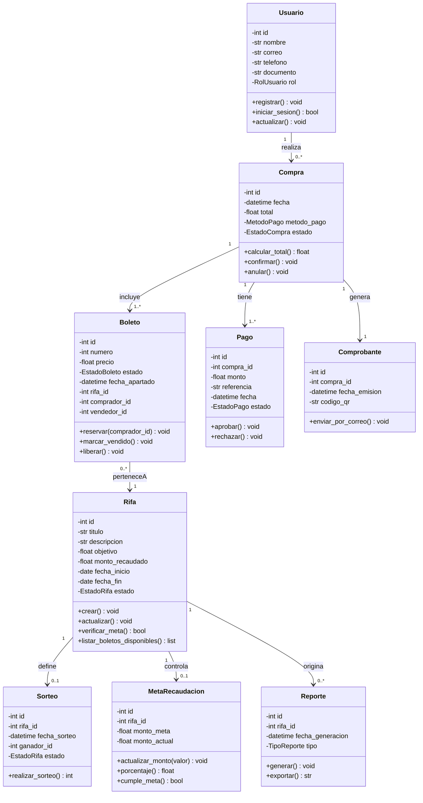

# 01 — Diagrama de clases (dominio, pasado a limpio)

Unifica tus 3 hojas de cuaderno + `ComprarBoleta.xmi`.
Correcciones aplicadas: nombres consistentes, tipos explícitos, estados como `enum`, se eliminan duplicados (ej. `Compra`/`Pago` separados, `MetaRecaudacion` separada de `Rifa`).

## Enums (no los dibujaste, pero los usabas en texto)

- `RolUsuario`: ADMIN, ORGANIZADOR, VENDEDOR, CLIENTE
- `EstadoRifa`: ACTIVA, FINALIZADA, CANCELADA
- `EstadoBoleto`: DISPONIBLE, APARTADO, PAGADO, VENDIDO, RECHAZADO
- `EstadoCompra`: PENDIENTE, CONFIRMADA, ANULADA
- `MetodoPago`: EFECTIVO, TRANSFERENCIA, TARJETA, PSE
- `EstadoPago`: PENDIENTE, APROBADO, RECHAZADO
- `TipoReporte`: CUENTAS, RECAUDACION, BOLETOS

## Decisiones de sentido

1. `Boleto` no guarda `total`; `Compra.calcular_total()` lo deriva (evita inconsistencia).
2. `Pago` separado de `Compra`: una compra puede tener varios intentos de pago.
3. `Sorteo` y `MetaRecaudacion` separados de `Rifa` (principio responsabilidad única).
4. `Comprobante` (caso Comprar Boleta) ≠ `Reporte` (cierre administrativo).
