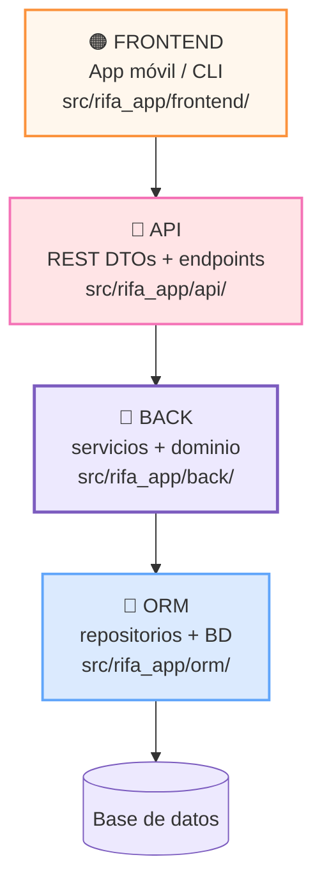

# 02 — Arquitectura 4 capas: FRONTEND · API · BACK · ORM

| Capa | Carpeta | Contiene | Puede llamar | Prohibido |
|------|---------|----------|--------------|-----------|
| FRONTEND | `frontend/` | pantallas, CLI demo | API | BACK/ORM directo |
| API | `api/` | `contratos.py`, `post_compras()` | BACK servicios | SQL, UI |
| BACK | `back/dominio/` + `back/servicios/` | entidades + reglas | interfaces ORM | HTTP, SQL |
| ORM | `orm/` | `RepositorioMemoria` → SQLite | dominio | servicios, UI |

> Ver versión bonita lista para revisión: `../ENTREGA_Revision.html` (morado pastel, imprimible).
