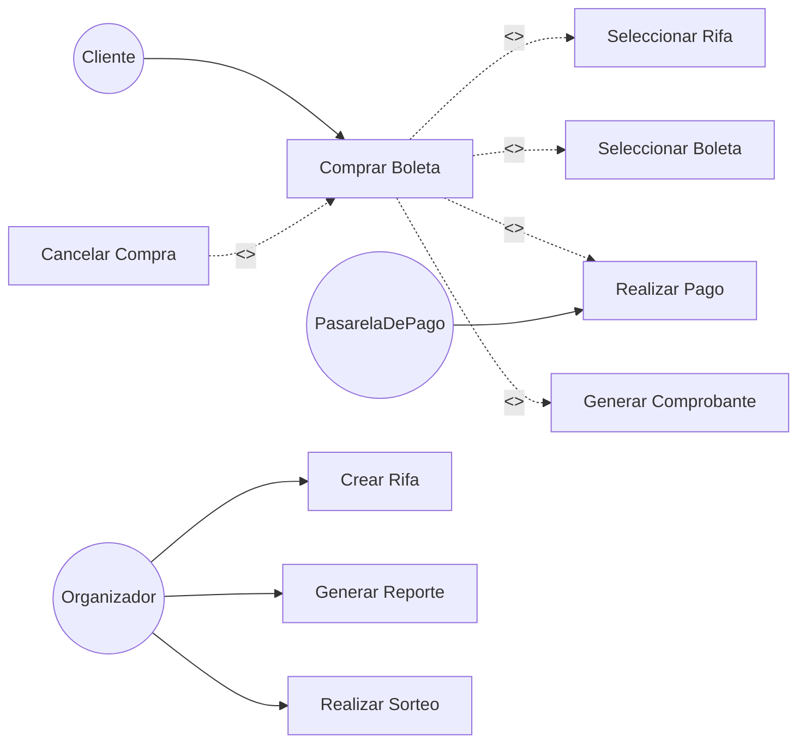

# 03 — Casos de uso (limpio)

## Actores
- **Cliente / Usuario**: compra y aparta boletos.
- **Organizador / Vendedor**: crea rifa, ve reportes.
- **PasarelaDePago**: actor secundario que valida el pago.

Tu XMI ya trae esto para Modelio (`Comprar Boleta` + 4 includes + 1 extend). Aquí se agregan `Crear Rifa`, `Generar Reporte` y `Realizar Sorteo` que estaban en tus hojas pero faltaban en el XMI.
