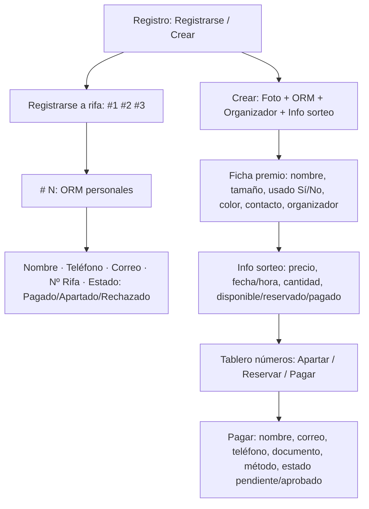

# 05 — Mockups y navegación (pasados a limpio)

Tus fotos de cuaderno, ordenadas sin cambiar la idea:

## Pantallas (qué lleva cada una)

1. **Registro**: dos botones — `Registrarse` (cliente) / `Crear` (organizador).
2. **Crear rifa (organizador)**: Foto/video + ORM objeto (nombre, tamaño, color, usado, contacto) + Info sorteo (precio, fecha/hora, cantidad).
3. **Catálogo / Ficha**: foto premio + datos + contador (disponibles / apartados / pagados).
4. **Tablero de números**: grilla 00-99, colores por `EstadoBoleto`.
5. **Apartar/Pagar**: formulario (nombre, correo, teléfono, documento, método) → estado PENDIENTE → APROBADO/RECHAZADO.
6. **Mis rifas**: participadas (#apartado, #pagado, #rechazado) + creadas (activa/finalizada/cancelada).

Tu mapa a mano que decía `Rifados → Usuario/Registro | Organizador/fotos/orm/sorteo` es exactamente este flujo.
